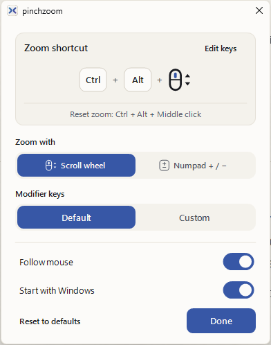

# pinchzoom

Hold your shortcut keys and scroll to zoom the whole Windows screen around your cursor, like macOS accessibility zoom or a touchpad pinch.

**[Download latest release (pinchzoom.exe)](https://github.com/linnathoncode/pinchzoom/releases/latest)**



## Controls

- **Zoom in / out:** `Ctrl + Alt + Scroll wheel` (or switch to `Numpad + / -` in settings)
- **Reset zoom:** `Ctrl + Alt + Middle click` (or `Numpad *`)
- **Custom modifiers:** click the shortcut card or pick `Custom` to record any combination of `Ctrl`, `Alt`, `Shift`, and `Win`
- **Follow mouse:** pans the zoomed view with your cursor when on, or locks the focal point in place when off
- **Tray app:** runs in the system tray; double-click the icon or launch the exe again to open settings, or pass `--background` to start hidden

## Lightweight by design

Written in Rust directly against Win32, GDI+, DWM, and the Windows Magnification API (`Magnification.dll`) with zero external crates:

- ~150 KB standalone executable
- ~2 to 6 MB private RAM
- 0% idle CPU when zoomed out to 100%

## Build

Requires Windows and the Rust MSVC toolchain:

```powershell
cargo build --release
```

The compiled binary is at `target\release\pinchzoom.exe`.
